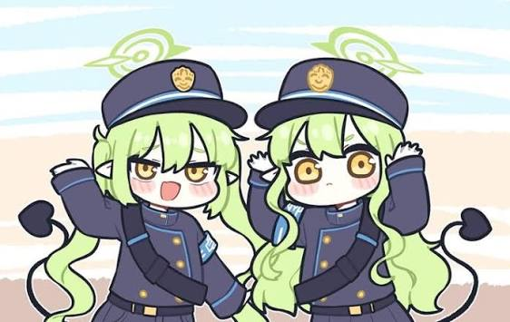

<p align="center">

  

</p>

# Nadenade Hikari

Game berbasis webcam yang terinspirasi dari permainan *whack-a-mole*, dengan konsep **watch-who-you-pet**. Pemain harus menemukan dan menepuk Hikari yang muncul pada berbagai posisi di area permainan.

Pemain menggerakkan tangan kanan di depan webcam untuk mengendalikan cursor. Ketika cursor berada pada target, pemain dapat menekan tombol `Z` untuk melakukan nadenade dan mendapatkan skor.

Program menggunakan webcam dan color tracking berbasis HSV untuk mendeteksi posisi tangan pemain.

Proyek tugas mata kuliah Pengolahan Citra dan Video (PCV).

## Konten

* `main.py` — aplikasi utama: webcam, game loop, dan perpindahan game state.
* `calibration.py` — proses kalibrasi warna untuk menentukan rentang HSV.
* `calibration.json` — batas HSV hasil proses kalibrasi warna.
* `states/game_state.py` — definisi state permainan.
* `states/menu_state.py` — tampilan dan logika menu utama.
* `states/cursor.py` — cursor yang mengikuti posisi tangan hasil deteksi.
* `states/game_mechanics.py` — mengurus gameplay pada game state.
* `states/losing_state.py` — digunakan untuk popup saat health habis
* `high_score.py` — menyediakan fungsi untuk high score.
* `high_score.json` — menyimpan nilai high score yang telah dicapai pemain.
* `assets/img/` — gambar Hikari dan aset visual lainnya.
* `assets/audio/` — efek suara dan audio game.
* `assets/font` — menyimpan font yang digunakan.

## Test

Aktifkan virtual environment:

```powershell
.\.venv\Scripts\Activate.ps1
```

Jalankan program:

```powershell
python main.py
```

Aplikasi akan membuka webcam dan menjalankan game.

Pada menu utama, pemain dapat menggerakkan tangan kanan untuk mengendalikan cursor.

Cursor dapat digunakan untuk memilih tombol pada menu. Tekan `Z` ketika cursor berada pada tombol yang ingin dipilih.

## Teknologi

| Nama         | Fungsi                                     |
| ------------ | ------------------------------------------ |
| Python 3.13  | Bahasa pemrograman                         |
| OpenCV       | Webcam dan pemrosesan gambar               |
| Pygame       | Game window, rendering, dan input keyboard |
| NumPy        | Pemrosesan data gambar                     |
| Git / GitHub | Version control                            |

## Cara Kerja

Pipeline utama program:

```text
Webcam
   ↓
OpenCV
   ↓
Frame Calibration
   ↓
HSV Color Detection
   ↓
Color Mask
   ↓
Hand Position
   ↓
Cursor Position
   ↓
Game Interaction
   ↓
Nadenade
   ↓
Game Response
```

Webcam menampilkan video dalam warna normal pada panel di sebelah kiri layar.

Frame kamera juga diproses dalam ruang warna HSV untuk mendeteksi warna yang telah ditentukan pada proses kalibrasi.

Batas warna hasil kalibrasi disimpan dalam:

```text
calibration.json
```

Contoh data kalibrasi:

```json
{
    "lower_hsv": [
        13,
        89,
        146
    ],
    "upper_hsv": [
        40,
        255,
        229
    ]
}
```

Nilai tersebut digunakan oleh OpenCV untuk membuat mask berdasarkan warna yang terdeteksi.

```text
Camera Frame
      ↓
     HSV
      ↓
   HSV Range
      ↓
   Color Mask
      ↓
Detected Position
```

Posisi hasil deteksi kemudian digunakan untuk menentukan posisi cursor pada layar.

Cursor akan mengikuti pergerakan tangan kanan pemain dan dapat digunakan untuk berinteraksi dengan elemen pada game.

## Gameplay

Gameplay menggunakan konsep **watch-who-you-pet** yang terinspirasi dari *whack-a-mole*.

Hikari akan muncul pada posisi tertentu di area permainan. Pemain harus menggerakkan tangan kanan untuk mengarahkan cursor menuju Hikari.

Ketika cursor berada pada Hikari, pemain dapat menekan:

```text
Z
```

untuk melakukan nadenade.

Konsep permainan juga menggunakan karakter Nozomi sebagai elemen pengganggu. Ketika pemain mencoba melakukan nadenade pada Nozomi, Nozomi dapat memberikan bom yang menjadi bagian dari sistem health permainan.

Alur dasar permainan:

```text
Target muncul
     ↓
Gerakkan tangan kanan
     ↓
Cursor menuju target
     ↓
Tekan Z
     ↓
Target berhasil dinadenade
     ↓
Game memberikan response
```

### Kontrol

| Input        | Fungsi                |
| ------------ | --------------------- |
| Right Hand   | Menggerakkan cursor   |
| `Z`          | Nadenade / interaksi  |
| Window Close | Keluar dari permainan |

## User Interface

Game menggunakan window berukuran:

```text
1280 × 720
```

Menu utama menggunakan layout dengan panel webcam di sebelah kiri dan area menu di sebelah kanan.

Camera preview menggunakan rasio 4:3 agar tampilan webcam tidak terdistorsi.

Cursor ditampilkan di atas game window dan mengikuti posisi tangan yang terdeteksi oleh sistem color tracking.

Visual menu dibuat menggunakan aset yang dirancang di Figma dan digunakan sebagai PNG pada Pygame.

## Progress

### 2026-09-13

* **Inisisasi game** Dikarenakan kurangnya informasi mengenai apakah model MediaPipe diizinkan atau tidak, saya mengulang progres dua minggu dengan membuat project baru tanpa MediaPipe.
* **Project setup.** Membuat project Python, virtual environment, dan struktur folder awal.
* **Color calibration.** Menggunakan HSV color tracking untuk mendeteksi warna yang telah dikalibrasi melalui webcam.
* **Game window.** Membuat window game berukuran 1280×720 menggunakan Pygame.
* **Game state system.** Membuat sistem state untuk memisahkan menu dan gameplay.
* **Main menu.** Membuat menu utama dengan area permainan dan panel webcam.
* **Camera preview.** Menampilkan webcam dalam warna normal dengan rasio 4:3 pada bagian kanan layar.
* **Gameplay concept.** Menentukan konsep permainan berupa whack-a-mole dengan Hikari sebagai karakter yang harus dinadenade.
* Repo ini mengikuti project lama saya sendiri (https://github.com/Kurumicchi/Daitaku-Helios-Simulator) yang seharusnya dijadikan untuk mata kuliah PCV sebelum ada rumor MediaPipe tidak diizinkan

### 2026-09-16
* **Menu layout.** Mengubah layout menu dengan menempatkan panel webcam di sebelah kiri dan area menu di sebelah kanan agar area permainan lebih nyaman digunakan dengan tangan kanan.
* **Hand cursor.** Membuat sistem cursor berbasis posisi tangan yang mengikuti pergerakan tangan kanan pemain pada game window.
* **Cursor interaction.** Menambahkan sistem collision antara cursor dan tombol menu untuk mendeteksi ketika cursor berada di atas tombol.
* **Button hover.** Menambahkan visual state untuk membedakan tombol yang sedang di-hover oleh cursor.
* **Input.** Menambahkan interaksi tombol menggunakan `Z`, sehingga pemain dapat memilih tombol menu menggunakan hand cursor.
* **Cursor module.** Memisahkan logika hand cursor ke dalam `states/cursor.py` agar lebih mudah digunakan kembali pada gameplay.

### 2026-09-19

* **Menu visual redesign.** Mendesain ulang tampilan menu utama agar lebih sesuai dengan tema visual Nadenade Hikari menggunakan aset yang dibuat di Figma.
* **Figma assets.** Mengintegrasikan aset visual dari Figma sebagai PNG ke dalam Pygame, termasuk background game area, side panel, title, high score, dan tombol menu.
* **Button states.** Menambahkan tiga visual state pada tombol menu: idle, hovered, dan pressed.
* **Button hitbox.** Menyesuaikan area collision tombol dengan area tombol sebenarnya pada aset PNG agar interaksi hand cursor lebih akurat.
* **Smooth cloud movement.** Menggunakan posisi floating-point untuk pergerakan awan agar kecepatan rendah tetap terlihat halus meskipun posisi pygame.Rect menggunakan integer.
* **BGM selection.** Memilih musik chiptune upbeat sebagai kandidat background music yang sesuai dengan suasana playful dan energetic pada game.

### 2026-10-04

* **Cursor update.** Memperbarui tampilan hand cursor agar terlihat lebih menarik dan sesuai dengan tema visual Nadenade Hikari.
* **Game state UI design.** Mendesain tampilan gameplay di Figma sebagai acuan visual untuk pengembangan antarmuka permainan.
* **Game state initialization.** Membuat modul `states/game_state.py` sebagai fondasi untuk implementasi gameplay, termasuk background game area, side panel, webcam, dan hand cursor.
* **State transition.** Mengintegrasikan perpindahan dari menu utama ke game state melalui tombol `Z` ketika hand cursor berada di atas tombol Start.
* **State structure.** Menyiapkan atribut `next_state` pada game state untuk mendukung sistem perpindahan antarlayar pada pengembangan selanjutnya.

### 2026-10-07
* **Game mechanics.** Membuat modul `states/game_mechanics.py` untuk menangani logika utama permainan, termasuk sistem grid, kemunculan karakter, timer, dan perubahan state setiap karakter.
* **Character system.** Mengimplementasikan sistem kemunculan karakter Hikari dan Nozomi secara acak pada area permainan.
* **Character state.** Mengembangkan state `EMPTY`, `APPEARING`, `ACTIVE`, `LEAVING`, `HIT`, dan `MISS` untuk mengatur siklus karakter selama permainan.
* **Interaction system.** Membuat sistem interaksi menggunakan hand cursor, sehingga karakter hanya dapat berinteraksi ketika berada dalam state `ACTIVE` dan cursor berada di dalam area karakter.
* **Score and health system.** Menambahkan sistem skor dan health, dengan Hikari memberikan tambahan skor ketika berhasil ditekan dan Nozomi mengurangi health pemain.
* **Difficulty progression.** Mengimplementasikan peningkatan kecepatan kemunculan karakter secara bertahap berdasarkan durasi permainan agar tingkat kesulitan meningkat seiring waktu.

### 2026-10-14
* **Score popup.** Menambahkan animasi popup skor setiap kali pemain berhasil menekan karakter Hikari, sehingga penambahan skor ditampilkan secara visual.
* **High score system.** Mengimplementasikan sistem penyimpanan high score menggunakan file JSON agar skor tertinggi tetap tersimpan meskipun permainan ditutup. High score ditampilkan pada menu dan diperbarui apabila pemain memperoleh skor yang lebih tinggi.
* **Health display.** Menambahkan tampilan tiga ikon hati untuk menunjukkan health pemain, dengan ikon hati yang berubah menjadi kosong ketika health berkurang.
* **Damage feedback.** Menambahkan efek kilatan merah (screen flash) dan guncangan layar (screen shake) setiap kali pemain menekan karakter Nozomi, sehingga dampak pengurangan health lebih terasa.
* **Game over and state transition.** Mengimplementasikan transisi kembali ke menu ketika health pemain mencapai nol, sekaligus memastikan high score diperbarui sebelum permainan berakhir.

### 2026-10-20
* **Losing screen.** Menambahkan tampilan layar kekalahan berupa popup yang muncul ketika health pemain mencapai nol, dengan latar belakang permainan yang dibuat buram agar fokus pemain tertuju pada popup.
* **Button interaction.** Menambahkan tombol **Restart** untuk memulai ulang permainan dan tombol **Quit** untuk kembali ke menu utama, dengan tampilan tombol yang berubah sesuai interaksi pemain.
* **Menu navigation.** Memperbarui fungsi tombol **Quit** pada menu utama agar pemain dapat keluar dari permainan.
* **Character visibility.** Memperbarui tampilan nama karakter Hikari dan Nozomi agar hanya muncul ketika karakter berada dalam state `ACTIVE`, sehingga identitas karakter tidak terlihat selama animasi kemunculan maupun transisi state lainnya.